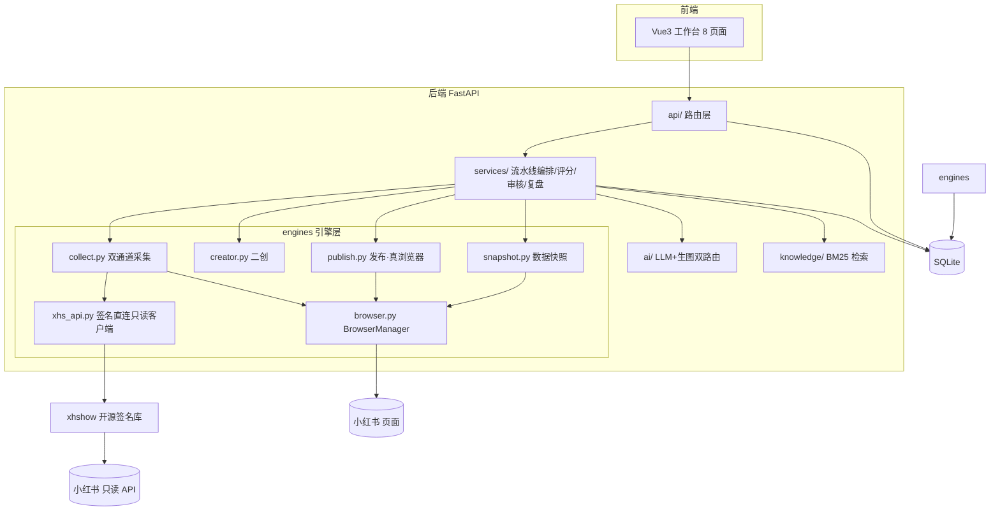

# XHS 运营助手（XHS Operator）


> 账号托管式小红书自动运营工具：**采集 → 分析 → 二创 → 审核 → 发布 → 数据 → 周复盘** 全闭环，人设与知识库驱动。本地单机运行，Python 全栈 + Vue3 工作台。

## 功能特性

| 模块 | 能力 |
|---|---|
| 采集 | 双通道：签名直连只读 API（xhshow，默认优先）+ Playwright 浏览器解析，hybrid 模式失败自动回退；限速防风控 |
| 分析 | 话题/关键词监测、人设匹配 + 知识库关键词 + 互动数加权评分，每日自动选篇 |
| 二创 | LLM 改写标题/文案 + 生图 API 二创（OpenAI 兼容双配置），相似度粗检 <70% |
| 审核 | 审核开关可配置；驳回原因自动转知识库负样本 |
| 发布 | Playwright 真浏览器操作创作者中心全配置项（定时/封面/话题/位置/声明/@/合集），提交后结果核查 + dedup 防重复 |
| 数据 | 笔记/账号数据快照、趋势看板、Top10、发布成功率 |
| 复盘 | 每周 LLM 归因生成改进方案，人工确认后写回知识库影响下一周期 |

## 安全与合规边界

**① 写操作仅真浏览器。** 一切变更类操作（发布/评论/点赞/收藏等）只通过 Playwright 真浏览器在页面上完成，**绝不签名直连、绝不携带 Cookie 调用任何写接口**。该红线写进代码注释、测试用例与 CI，任何变更类接口字面量出现在源码中即测试失败。

**② 读操作提供 API 直连通道。** 采集（搜索/笔记详情/评论）提供签名直连只读 API 通道，签名基于 PyPI 公开开源库 [xhshow](https://pypi.org/project/xhshow/)，与 MediaCrawler、Spider_XHS 等项目同一公开生态；本仓库不含任何自研签名或逆向代码。接口白名单硬管控（`READ_ENDPOINTS`），仅允许只读接口。Cookie 复用浏览器扫码登录态，只读导出。

**③ 仅供学习交流。** 本项目仅供个人学习与技术交流，使用须遵守小红书平台规则与相关法律法规；账号风险自担；禁止用于任何违法用途。详见 [LICENSE](LICENSE) 免责声明。

## 快速开始

```bash
# 1. Python 3.11+ 环境
cd backend
python -m pip install -r requirements.txt
python -m playwright install chromium

# 2. 配置（可选，默认配置即可启动）
copy config.example.yaml config.yaml

# 3. 启动（项目根目录）
cd ..
python run.py          # 或 Windows 双击 start.bat
```

启动后浏览器自动打开工作台（默认 `http://127.0.0.1:8787`）。首次使用请在工作台弹出的浏览器窗口中扫码登录小红书——登录态同时供浏览器通道与 API 采集通道使用。

前端开发模式（可选）：`cd frontend && npm install && npm run dev`（构建产物输出到 backend/static 由后端直接托管）。

## 配置说明

| 配置项 | 位置 | 默认值 | 说明 |
|---|---|---|---|
| server.host / port | config.yaml | 127.0.0.1 / 8787 | 本机监听，不对外网开放 |
| data.* | config.yaml | ./data | 数据库/图片/截图/浏览器 profile 目录 |
| browser.headless | config.yaml | false | 小红书风控敏感，默认有头浏览器 |
| collect_read_mode | 设置页 API / AppSetting | hybrid | 采集通道：`browser` 仅浏览器 / `api` 仅签名直连 / `hybrid` API 优先失败回退浏览器 |
| review_required | 设置页 API | true | 二创人工审核开关（D6） |
| publish_slots | 设置页 API | 10:00/15:00/19:00 | 每日发布槽位 |
| AI 配置（llm/image） | 工作台「设置」页 | — | base_url / api_key / model 存 ai_config 表，接口返回脱敏 |

环境变量 `XHS_PORT` / `XHS_HOST` / `XHS_DATA_DIR` / `XHS_LOG_LEVEL` 可覆盖同名配置。

## 架构简图



采集限速：同任务相邻请求 ≥2.5s + 0~35% 抖动，搜索翻页间隔 ≥10s；失败计入日志与流水线状态（PipelineRun 状态机），hybrid 模式自动降级不阻塞当日流水线。

## FAQ

**为什么发布不走 API？**
发布是写操作，涉及账号资产与平台风控红线。本项目设计上规定：一切变更类操作只在真实浏览器中以真实用户操作路径完成，提交后还会回笔记列表核查结果，宁可慢也不走签名直连写接口——这既是合规考量，也是防封号的稳健做法。

**Cookie 从哪来？**
来自你在工作台浏览器中扫码登录后的 Playwright persistent context（`data/profiles/account_1`）。API 采集通道启动时只读导出该登录态 Cookie（含 a1 / web_session）用于签名请求；不落明文文件、不用于任何写接口。

**会被封号吗？怎么降低风险？**
任何自动化操作都有平台风控风险。本项目的缓解措施：发布走真浏览器、采集默认 hybrid + 严格限速（≥2.5s 请求间隔 / ≥10s 翻页间隔 + 抖动）、浏览器有头模式模拟真人、失败自动降级不重试轰炸。但无法承诺零风险——请控制使用频率，账号风险自担。

## 文档索引

- `docs/PRD.md` — 产品需求文档
- `docs/架构设计.md` — 系统设计与任务分解
- `docs/操作手册要点.md` — 使用要点

## 致谢

- [xhshow](https://pypi.org/project/xhshow/) — 公开开源签名库（API 只读通道）
- [aspy1027/xhs-personal](https://github.com/aspy1027/xhs-personal) — 产品路线参考
- [NanmiCoder/MediaCrawler](https://github.com/NanmiCoder/MediaCrawler) — 公开采集生态参考
- [cv-cat/Spider_XHS](https://github.com/cv-cat/Spider_XHS) — 接口适配参考
- [xiaohongshu-mcp](https://github.com/xpwnt/xiaohongshu-mcp) — 浏览器自动化选择器经验
- [social-auto-upload](https://github.com/dreammis/social-auto-upload) — 多平台发布自动化思路

## 免责声明

本项目仅供学习交流，使用时须遵守小红书平台规则与相关法律法规；账号风险与使用后果由使用者自行承担。详见 [LICENSE](LICENSE)。

---
*由 software-company 专家团（齐活林/许清楚/高见远/寇豆码/严过关）按 SOP 协作开发。*
