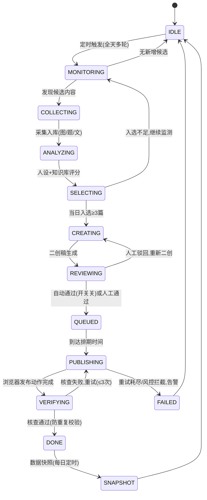
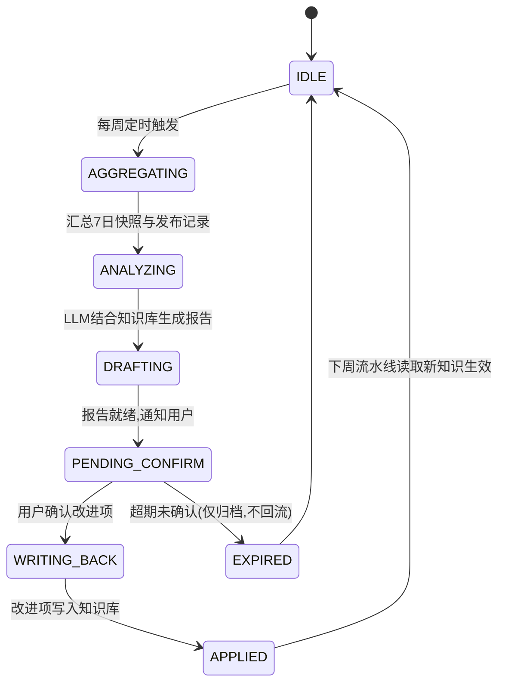

# 「XHS 运营助手」产品需求文档（PRD）

- **版本**：v0.1（简单 PRD）
- **作者**：产品经理 许清楚（Xu）
- **日期**：2025 年
- **状态**：待评审

---

## 1. 产品目标

「XHS 运营助手」是一款本地单机运行的小红书账号全托管运营工具。客户把账号"交给我们"：系统全天候主动监测客户指定的话题/标签，自动采集优质笔记（图文），基于客户专属**人设**与**运营知识库**对标题、文案、图片进行 AI 二创，通过**真浏览器自动化**按创作者服务中心的完整配置项定时发布，并对账号数据进行每日快照与**每周复盘**，复盘结论回流进知识库，形成"采集 → 分析 → 二创 → 发布 → 数据 → 复盘 → 改进"的自动化闭环。

**可量化目标：**

| # | 目标 | 衡量标准 |
|---|------|----------|
| G1 | 无人值守日更 | 配置完成后，连续 7 天每日自动完成 ≥3 篇采集、二创、发布，人工干预 ≤1 次/天（仅审核场景） |
| G2 | 二创可用率 | 二创产出的笔记（标题+文案+图片）人工免改直发通过率 ≥70% |
| G3 | 复盘驱动改进 | 每周自动产出 1 份复盘报告，含 ≥3 条可执行改进项，且 ≥80% 改进项能在下一周被系统自动应用（调话题权重/调人设提示词/调发布时间） |

---

## 2. 目标用户与使用场景

**目标用户：**

1. **个人博主/副业博主**：有创作意愿但无时间持续产出，希望账号被"代运营"。
2. **小微商家/电商卖家**：需要在小红书持续种草引流，无专职运营人员。
3. **代运营服务商**：同时服务少量账号（MVP 单账号，后续扩展），需要标准化流水线。

**典型使用场景：**

- 场景 A：用户首次使用，录入 AI 配置（文案 LLM + 生图 API），制作一个"家居好物分享"人设，导入自有运营经验文档，配置 5 个话题标签 → 系统开始全天自动运转。
- 场景 B：用户开启"二创人工审核"模式，每天早上花 10 分钟在工作台审核昨日二创稿，一键通过进入发布队列。
- 场景 C：每周一，用户打开「复盘」页，查看上周数据周报与改进项，确认后改进项自动写入知识库并在本周生效。
- 场景 D：发布异常（浏览器自动化失败/风控拦截），系统在数据页醒目告警，用户排查后重试。

---

## 3. 用户故事

1. **人设制作**：作为博主，我想创建一个包含昵称定位、内容风格、目标人群、禁忌词的人设，并指定其为当前生效人设，以便采集、二创、发布的所有环节都符合我的人设调性。
2. **知识导入**：作为运营者，我想把我的运营经验文档（txt/md/docx）、每周复盘结论一键导入知识库，以便系统在分析与创作时参考我的方法论而非凭空发挥。
3. **话题配置**：作为用户，我想配置多个监测话题/关键词及其采集优先级（每话题每日采集篇数），以便系统全天候按计划选题。
4. **每日自动流水线**：作为用户，我想让系统每天自动完成"监测 → 采集 → 分析筛选 → 二创 → 排期发布"，以便账号无人值守也能日更。
5. **二创审核（可选开关）**：作为谨慎型用户，我想开启人工审核，对二创稿的标题/文案/图片预览并编辑或驳回，以便控制发布质量。
6. **发布配置**：作为用户，我想在发布时使用与小红书创作者服务中心一致的全部可选项（标题、正文、图片、封面、话题、定时发布、位置、声明来源、合集、@好友等），以便发布的笔记完整、合规。
7. **数据看板**：作为用户，我想查看每篇笔记的曝光/点赞/收藏/评论快照与账号整体趋势，以便了解运营效果。
8. **周复盘与改进回流**：作为用户，我想每周自动收到一份复盘报告（数据表现、爆款归因、问题诊断、改进项），且改进项一键确认后写入知识库并影响下周运行，以便账号持续变好。

---

## 4. 需求池

### P0（MVP 必须，按里程碑排序）

| ID | 里程碑 | 需求 | 验收标准 |
|----|--------|------|----------|
| R01 | M1 基础框架 | 本地应用骨架：FastAPI 后端 + SQLModel/SQLite 存储 + Vue3/Vite 工作台前端，单机 Windows 一键启动 | 双击/脚本启动后浏览器打开工作台，前后端联通，数据库自动初始化 |
| R02 | M1 基础框架 | AI 双配置管理：文案 LLM（OpenAI 兼容 chat/completions）与生图 API 的 base_url/model/key 可配置并连通性测试 | 保存配置后点击"测试"，两类 API 各返回一次成功调用结果 |
| R03 | M2 人设 | 人设系统：创建/编辑/启停人设（定位、风格、目标人群、禁忌词、示例笔记），全流程注入人设上下文 | 存在 ≥2 个人设时可切换；切换后采集筛选与二创的提示词中可见对应人设内容（日志可查） |
| R04 | M2 知识库 | 知识库导入接口：支持 txt/md/docx 文件导入与文本粘贴导入，切片入库，检索供分析/二创/复盘使用；周复盘结论可自动写入 | 导入一份 ≥5000 字文档后，二创提示词中能检索引用到相关片段 |
| R05 | M3 采集与选题 | 话题管理：增删话题/关键词、设置采集时段与每话题每日篇数 | 配置 3 个话题后，调度日志显示按计划触发 |
| R06 | M3 采集与选题 | 全天候话题监测与采集：Playwright 浏览器打开小红书搜索页读取笔记列表（图片、标题、文案、作者、互动数），按人设+知识库评分选出 ≥3 篇/日 | 单次采集任务至少入库 1 篇结构完整（含图片 URL）的笔记；每日累计 ≥3 篇通过筛选 |
| R07 | M4 二创 | 二创引擎：对采集笔记的标题、文案基于人设+知识库改写（LLM），图片基于生图 API 二创（改绘/换风格），产出二创稿 | 每篇采集笔记生成 1 份二创稿，含新标题、新文案、新图片，且与原文重复率低（标题/文案相似度 <70%） |
| R08 | M4 二创 | 二创审核（可开关）：审核页展示原稿 vs 二创稿，支持编辑、通过、驳回 | 关闭开关时二创稿直接入发布队列；开启时未审核稿件不发布 |
| R09 | M5 发布 | 发布引擎：Playwright 真浏览器操作创作者服务中心发布页，支持配置项：标题、正文、图片、封面、话题、定时发布、位置、声明来源、合集、@好友 | 以定时发布模式成功发出 1 篇含图笔记，发布后页面核查笔记存在且内容一致 |
| R10 | M5 发布 | 发布结果核查与防重复：发布后读取笔记列表核对；发布前查重（同内容/同图不重发）；失败重试与告警 | 模拟重复任务时系统拒绝二次发布并记录告警 |
| R11 | M6 数据 | 数据快照：定时读取已发布笔记的曝光/点赞/收藏/评论与账号整体数据，存 SQLite | 每篇笔记每日 ≥1 条快照记录，数据页可展示趋势 |
| R12 | M7 复盘 | 每周复盘：汇总周数据 + 知识库，LLM 产出复盘报告（表现、归因、诊断、≥3 条改进项），用户确认后改进项写入知识库 | 每周自动生成 1 份报告；确认后知识库新增对应条目并在下次二创提示词中生效 |
| R13 | 全程 | 调度与流水线状态机：APScheduler 编排每日流水线（监测→采集→筛选→二创→审核→发布→快照），状态可查询、失败可重试 | 任一环节失败不阻塞后续天次；流水线状态页实时可见当前环节 |

### P1（应该有）

| ID | 需求 | 验收标准 |
|----|------|----------|
| R14 | 多账号管理（矩阵） | ≥2 个账号独立人设/话题/排期，切换无串数据 |
| R15 | 采集候选池与人工选题页 | 采集结果进入候选池，用户可手动加选/排除 |
| R16 | 发布日历视图 | 日历展示已排期/已发布笔记，支持拖拽调整时间 |
| R17 | 爆款归因分析 | 对高互动笔记做要素拆解（标题句式/封面类型/话题组合）并写入知识库 |
| R18 | 图片素材库与封面模板 | 二创图片可复用素材库，封面支持模板化生成 |
| R19 | 发布风险提示 | 发布前对文案做违禁词/敏感词检查并提示 |

### P2（可以有）

| ID | 需求 | 验收标准 |
|----|------|----------|
| R20 | WebRTC/远程浏览器接管（异地托管） | 远程会话可查看与接管自动化浏览器 |
| R21 | 评论自动回复 | 基于 LLM 生成回复草稿，审核后发送 |
| R22 | 视频笔记支持 | 二创与发布支持视频类笔记 |
| R23 | 数据导出（CSV/Excel） | 数据页一键导出快照数据 |
| R24 | 运行报告推送（企业微信/邮件） | 每日/每周报告自动推送到指定渠道 |

---

## 5. 核心页面 UI 设计稿说明（8 个页面）

整体布局：左侧固定导航栏（8 项），顶部状态条（当前人设、流水线状态灯、AI 连通状态、今日发布数），主内容区。Vue3 + 简洁工作台风格，浅色为主。

1. **工作台（Dashboard）**：顶部 4 个指标卡（今日采集/今日二创/今日发布/待审核）；中部"流水线状态"时间轴（当前环节高亮）；下方"今日发布列表"与"告警通知"两栏。
2. **人设管理**：左侧人设卡片列表（启用中带徽标）；右侧编辑表单：基本信息（昵称/定位）、风格标签（多选+自定义）、目标人群、禁忌词、示例笔记（可贴多条）；顶部"设为当前生效"开关。
3. **知识库**：顶部导入区（拖拽上传 txt/md/docx + 文本粘贴框 + "来源"标注：人工经验/周复盘）；中部条目列表（标题、来源、字数、入库时间、启用开关）；右侧检索预览框（输入查询，展示命中片段）。
4. **采集与选题**：上部话题卡片（关键词、时段、每日篇数、启停）；中部"今日监测日志"（滚动时间线）；下部"已采集/已入选"双列表，展示缩略图、标题、互动数、人设匹配分。
5. **二创审核**：左右对照布局——左"原始笔记"（图/题/文），右"二创稿"（可内联编辑标题与文案、图片预览与换图）；底部操作条：通过 / 驳回（驳回需填原因，原因入知识库作负样本）；顶部筛选（待审/已通过/已驳回）。
6. **发布日历**：月历视图，日期格内显示待发布/已发布笔记缩略块（颜色区分状态）；点击弹出发布配置抽屉：标题、正文、图片、封面、话题（多选）、定时时间、位置、声明来源、合集、@好友——字段与创作者服务中心一致；抽屉底部"立即试发预检"。
7. **数据看板**：顶部账号级指标卡（粉丝数、周曝光、周互动、发帖数）；中部"互动趋势折线图"与"笔记表现 Top10 表格"（曝光/赞/藏/评/快照时间）；底部"发布成功率与失败原因"统计条。
8. **复盘**：上部周选择器 + 报告卡（表现摘要、爆款归因、问题诊断，分节渲染 Markdown）；下部"改进项"复选列表（每条含影响范围说明，如"话题权重/发布时间/提示词"）；底部"确认并写入知识库"按钮，确认后显示回流状态。

---

## 6. 状态机（Mermaid）

### 每日流水线

### 每周复盘闭环

---

## 7. 运行前置条件与待确认问题

### 运行前置条件（现实约束，部署时必须满足）

- 客户需提供：可用的文案 LLM API（OpenAI 兼容）与生图 API 的 base_url/model/key；一台 Windows 常开电脑；已登录小红书的浏览器环境（首次扫码登录由用户完成，系统只做自动化操作，不逆向签名、不直连 Cookie API）。

### 待确认问题清单

| # | 问题 | 是否阻塞 MVP |
|---|------|--------------|
| Q1 | 生图 API 的具体形式（OpenAI 兼容 images 接口？还是自定义 HTTP 服务？）——影响图片二创适配层设计 | **阻塞**（M4 二创） |
| Q2 | MVP 是单账号还是需支持多账号？当前按单账号设计，多账号放 P1，需客户确认 | **阻塞**（影响数据模型） |
| Q3 | 图片二创的合规尺度：完全 AI 生成新图，还是允许对原图做轻度处理（裁剪/滤镜/局部重绘）？涉及版权与平台风控 | 非阻塞（默认取保守方案：AI 重绘为主） |
| Q4 | 发布频率与时段策略：每日固定 N 篇还是按知识库/复盘动态调整发布时间？ | 非阻塞（默认固定时段，P1 动态化） |
| Q5 | 知识库文档是否有现成语料（客户自有运营经验）首批可导入？规模与格式？ | 非阻塞（接口先做，语料后补） |
