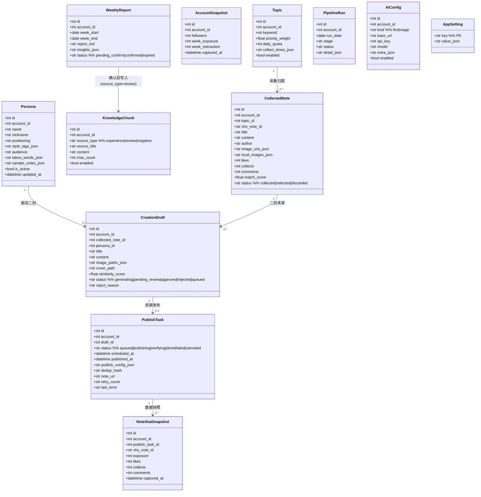
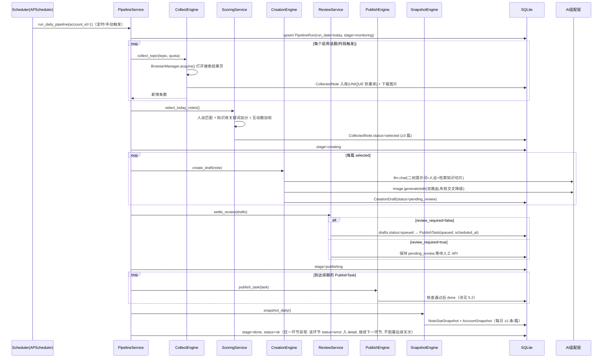
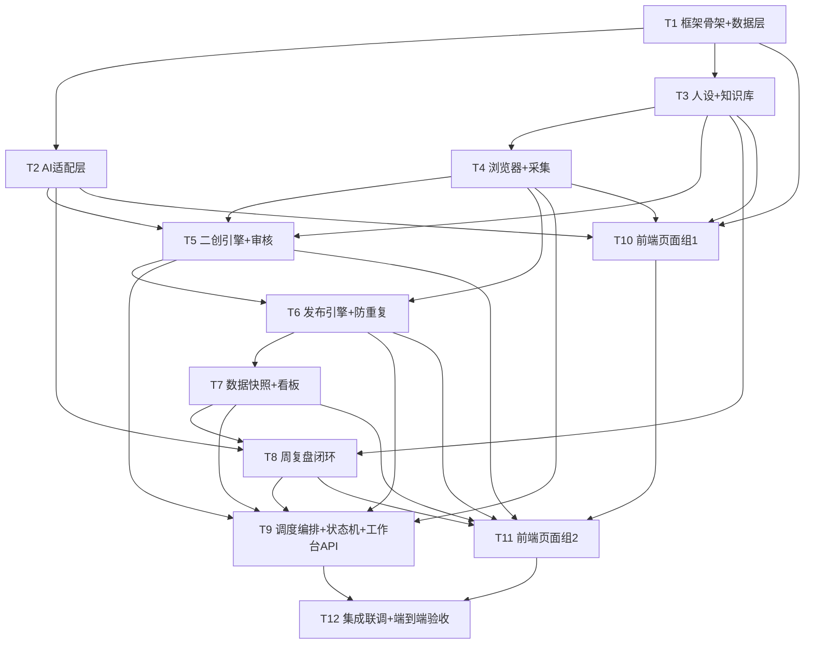

# 「XHS 运营助手」系统架构设计 + 任务分解

- **作者**：架构师 高见远（Gao / Bob）
- **日期**：2025 年
- **依据**：`docs/PRD.md`（R01~R13 P0 需求，M1~M7 里程碑）+ `xhs-personal 分析报告` + CreatorHub 参考实现
- **已拍板决策**：D1 生图双路由适配 / D2 MVP 单账号（表带 account_id）/ D3 只走真浏览器、绝不逆向签名 / D4 Python 全栈 + Vue3 / D5 关键词检索（预留向量接口）/ D6 二创审核默认开启可配置

---

# Part A：系统设计

## 1. 实现方案

### 1.1 核心技术挑战与对策

| 挑战 | 对策 |
|---|---|
| 小红书无公开 API，采集/发布只能走页面 | Playwright chromium **persistent context**（每账号独立 `data/profiles/account_1`），首次扫码登录后长期复用登录态；采集=读搜索结果页 DOM，发布=操作创作者服务中心表单。**绝不逆向签名/Cookie 直连** |
| 发布结果不确定（提交后可能成功但页面提示不明确） | 借鉴 xhs-personal：提交后不盲目重试，去笔记列表页**核查笔记存在且内容一致**；发布前用 `dedup_hash`（标题+图片指纹）查重，防重复发布 |
| AI 服务异构（文案 LLM 与生图 API 形式不一，生图有 JSON/dataURI 与 multipart/edits 两种形态） | 独立 `app/ai/` 适配层：`llm.py` 走 OpenAI 兼容 `/chat/completions`；`image.py` 实现 `/images/generations`（JSON+dataURI）与 `/v1/images/edits`（multipart）**双路由，失败自动交叉降级**，base_url/api_key/model 全可配（默认 lk888.ai / tt-image-2.5 / banana 系） |
| 全天候多环节编排，任一环节失败不能阻塞后续天次 | APScheduler 触发 + `PipelineRun` 状态机记录 stage/status/detail；每环节独立 try/except，失败告警入 Dashboard |
| 知识检索不引重依赖 | SQLite 存切片 + 关键词/BM25 打分（纯 Python 实现），`retrieve.py` 预留 `Retriever` 接口便于将来换向量方案 |
| 复盘改进项要"回流生效" | 改进项按 `scope`（topic_weight / publish_time / prompt）结构化 JSON 存 `WeeklyReport.insights`，确认后转为 `KnowledgeChunk(source_type='review')` 入库，并在评分/提示词构建时按 scope 优先注入 |

### 1.2 框架选型与理由

- **FastAPI + SQLModel + SQLite**：单机本地应用，零部署负担；SQLModel 让表定义即 Pydantic 校验，参考 CreatorHub 的 `main.py` + `db.py` + `models.py` 分层。
- **APScheduler（BackgroundScheduler/AsyncIOScheduler）**：轻量够用，支持 cron 表达式（话题采集时段、每日快照、每周复盘）。
- **Playwright（sync API 放线程池执行）**：persistent context 天然保登录态；浏览器操作统一收敛到 `engines/browser.py` 的 `BrowserManager` 单例，页面按需租借（`acquire()`），避免并发开多浏览器。
- **httpx**：AI 适配层 HTTP 客户端，异步友好。
- **Pillow**：二创图片后处理（尺寸校验、封面裁剪）、图片指纹（dedup_hash）。
- **python-docx**：知识库 docx 导入解析。
- **Vue3 + Vite（无重型 UI 库，手写简洁工作台风格 + 原生 fetch）**：8 个页面均为表单+列表+图表，用 ECharts CDN 仅数据看板折线图一处，保持前端依赖最小。

### 1.3 架构模式

**分层架构（参考 CreatorHub FastAPI 分层）+ 引擎模式**：

```
Vue3 单页工作台
      │ HTTP (统一 {code,data,message})
      ▼
api/ 路由层（按资源域拆分 router，纯参数校验与转发）
      ▼
services/ 业务服务（流水线编排、评分筛选、审核流转、复盘汇总——无 IO 细节）
      ▼
engines/ 引擎层（浏览器采集、二创、发布、快照——唯一接触 Playwright 的地方）
engines + ai/ + knowledge/（AI 适配与知识检索，engines 可调用）
      ▼
models.py (SQLModel/SQLite)   scheduler.py (APScheduler 触发 services)
```

约束：`api/ 不直接调 engines/`，`engines/ 不反向 import api/`，跨层只经 services/。

## 2. 文件列表（相对 `XHS运营助手/` 根）

```
XHS运营助手/
├── start.bat                        # Windows 一键启动脚本（起后端+自动开浏览器）
├── run.py                           # Python 启动入口：uvicorn + 打开工作台页面
├── docs/                            # PRD、本设计文档
├── backend/
│   ├── requirements.txt             # 依赖清单
│   ├── config.example.yaml          # 服务器级配置模板（端口/数据目录/profile 路径），注释风格仿 CreatorHub
│   ├── app/
│   │   ├── __init__.py              # 包标识
│   │   ├── main.py                  # FastAPI 入口：lifespan(init_db→启动 scheduler→预热 BrowserManager)，挂载 api routers 与前端静态资源
│   │   ├── config.py                # 统一配置读取：config.yaml + 环境变量覆盖，单例 get_settings()
│   │   ├── db.py                    # SQLite engine/Session/init_db（自动建表+种子数据：默认账号、AppSetting 默认值）
│   │   ├── models.py                # 全部 SQLModel 表定义（含索引与 account_id）
│   │   ├── errors.py                # EngineError/AiError/VerifyError 异常体系 + 统一响应包装
│   │   ├── api/
│   │   │   ├── __init__.py          # 汇总挂载各 router
│   │   │   ├── dashboard.py         # 工作台聚合指标、流水线状态、告警列表
│   │   │   ├── personas.py          # 人设 CRUD、启停、设为生效
│   │   │   ├── knowledge.py         # 知识导入(文件/粘贴)、列表、启停、检索预览
│   │   │   ├── topics.py            # 话题 CRUD、时段/每日篇数、启停、手动触发采集
│   │   │   ├── collected.py         # 已采集列表、入选/淘汰、匹配分
│   │   │   ├── creations.py         # 二创稿列表、原稿对照详情、编辑、通过/驳回、手动触发二创
│   │   │   ├── publish.py           # 发布任务 CRUD、日历视图、试发预检、重试、防重复说明
│   │   │   ├── stats.py             # 账号/笔记数据看板、手动触发快照
│   │   │   ├── reports.py           # 周报列表、详情、确认改进项写入知识库
│   │   │   └── settings.py          # AI 双配置读写、连通性测试、审核开关等 AppSetting
│   │   ├── services/
│   │   │   ├── __init__.py
│   │   │   ├── pipeline.py          # 每日流水线状态机：监测→采集→筛选→二创→审核→发布→快照，逐环节 try/except，写 PipelineRun
│   │   │   ├── scoring.py           # 人设+知识库评分：给 CollectedNote 打 match_score 决定入选
│   │   │   ├── context.py           # 提示词上下文构建：当前人设 + 检索命中的知识切片 + 复盘改进项注入
│   │   │   ├── review.py            # 审核流转：开关判断自动通过、驳回原因转负样本知识条目
│   │   │   └── report_service.py    # 周数据汇总 + 调 LLM 生成复盘报告 + 改进项确认回流
│   │   ├── engines/
│   │   │   ├── __init__.py
│   │   │   ├── browser.py           # BrowserManager 单例：chromium persistent context、页面租借 acquire()、登录态检查、截图留痕
│   │   │   ├── collect.py           # 采集引擎：打开搜索结果页解析列表项（图/题/文/作者/互动数），下载图片到本地
│   │   │   ├── creator.py           # 二创引擎：调 ai 层改写标题/文案、生图二创、相似度粗检（<70%）
│   │   │   ├── publish.py           # 发布引擎：填创作者中心表单全配置项 + 提交 + 结果核查（防重复）+ 重试
│   │   │   └── snapshot.py          # 快照引擎：读创作者中心数据页，写 NoteStatSnapshot / AccountSnapshot
│   │   ├── ai/
│   │   │   ├── __init__.py          # 导出统一调用入口
│   │   │   ├── llm.py               # OpenAI 兼容 chat/completions 客户端，统一 AiResult 返回
│   │   │   ├── image.py             # 生图双路由：generations(JSON/dataURI) ⇄ edits(multipart)，失败交叉降级
│   │   │   └── prompts.py           # 提示词模板：二创改写、评分归因、周报生成（占位符注入 context）
│   │   ├── knowledge/
│   │   │   ├── __init__.py
│   │   │   ├── ingest.py            # txt/md/docx 解析 → 按段落/长度切片 → 入库 KnowledgeChunk
│   │   │   └── retrieve.py          # 关键词/BM25 打分检索（纯 Python），Retriever 协议预留向量扩展
│   │   └── scheduler.py             # APScheduler：话题时段采集、每日流水线、每小时快照、每周复盘、任务重试扫描
│   └── tests/
│       ├── test_ai.py               # AI 适配层降级逻辑单测（mock httpx）
│       └── test_publish_dedup.py    # 防重复核查单测（mock 引擎结果）
├── frontend/
│   ├── package.json                 # vue3 + vite 最小依赖
│   ├── vite.config.js               # dev 代理 /api → 127.0.0.1:8787；build 输出到 backend 静态目录
│   ├── index.html
│   └── src/
│       ├── main.js                  # 挂载 App
│       ├── App.vue                  # 路由切换壳
│       ├── api.js                   # fetch 封装（统一 {code,data,message} 解包、错误 toast）
│       ├── store.js                 # 响应式全局状态（当前人设、流水线状态灯、AI 连通状态、告警）
│       ├── style.css                # 浅色工作台全局样式
│       ├── components/
│       │   └── Layout.vue           # 左侧 8 项导航 + 顶部状态条
│       └── pages/
│           ├── Dashboard.vue        # 4 指标卡 + 流水线时间轴 + 今日发布/告警两栏
│           ├── Personas.vue         # 人设卡片列表 + 编辑表单 + 生效开关
│           ├── Knowledge.vue        # 导入区(拖拽/粘贴) + 条目列表 + 检索预览
│           ├── Collect.vue          # 话题卡片 + 监测日志时间线 + 已采集/已入选双列表
│           ├── Review.vue           # 原稿 vs 二创稿对照、内联编辑、通过/驳回
│           ├── PublishCalendar.vue  # 月历视图 + 发布配置抽屉（全配置项）+ 试发预检
│           ├── Stats.vue            # 账号指标卡 + ECharts 趋势折线 + Top10 表 + 成功率
│           └── Reports.vue          # 周选择器 + Markdown 报告 + 改进项确认回流
```

共 38 个文件（backend 24 / frontend 14），符合 25~40 预估。

## 3. 数据结构

### 3.1 类图（模型与服务总览）



### 3.2 核心表 DDL 级描述（SQLModel，均在 `models.py`）

约定：所有业务表含 `account_id: int = Field(default=1, index=True)`；时间字段统一本地时区 `Asia/Shanghai` 的 naive datetime，序列化为 ISO 8601 字符串。

1. **persona** — 人设
   `id PK` / `account_id` / `name`（人设名）/ `nickname`（账号昵称定位）/ `positioning`（一句话定位）/ `style_tags`（JSON 数组）/ `audience`（目标人群）/ `taboo_words`（JSON 数组，禁忌词）/ `sample_notes`（JSON 数组，示例笔记文本）/ `is_active: bool` / `created_at` / `updated_at`
   索引：`(account_id, is_active)`。约束：同 account 至多一条 `is_active=1`（服务层保证）。

2. **knowledge_chunk** — 知识切片
   `id PK` / `account_id` / `source_type`（`experience` 人工经验 | `review` 周复盘 | `negative` 驳回负样本）/ `source_title` / `content: text` / `char_count` / `enabled: bool` / `created_at`
   索引：`(account_id, source_type)`、`(account_id, enabled)`。检索在 Python 侧做 BM25 打分，不建全文索引。

3. **topic** — 监测话题
   `id PK` / `account_id` / `keyword` / `priority_weight: float`（评分加权）/ `daily_quota: int`（每日篇数）/ `collect_times`（JSON 数组，"09:00" 等 cron 触发时刻）/ `enabled: bool` / `created_at`
   索引：`(account_id, enabled)`。

4. **collected_note** — 采集笔记（`UNIQUE(account_id, xhs_note_id)` 防重采）
   `id PK` / `account_id` / `topic_id FK` / `xhs_note_id` / `title` / `content: text` / `author` / `image_urls`(JSON) / `local_images`(JSON，下载到 `data/collected/`) / `likes/collects/comments: int` / `match_score: float` / `status`（`collected` 已采集 | `selected` 已入选 | `discarded` 已淘汰）/ `collected_at`
   索引：`(account_id, status)`、`(account_id, collected_at)`。

5. **creation_draft** — 二创稿
   `id PK` / `account_id` / `collected_note_id FK` / `persona_id FK` / `title` / `content: text` / `image_paths`(JSON，`data/creations/`) / `cover_path` / `similarity_score: float`（与原稿标题+文案相似度，要求 <0.70）/ `status`（`generating|pending_review|approved|rejected|queued`）/ `reject_reason` / `created_at` / `updated_at`
   索引：`(account_id, status)`。

6. **publish_task** — 发布任务（状态机：queued→publishing→verifying→done / failed / canceled）
   `id PK` / `account_id` / `draft_id FK` / `status` / `scheduled_at` / `published_at` / `publish_config`（JSON：topics[]、location、source_declare、collection、mention_users[]、is_schedule 等创作者中心全配置项）/ `dedup_hash`（SHA1(标题+图片字节指纹)，`UNIQUE(account_id, dedup_hash)` 硬防重发）/ `note_url` / `xhs_note_id` / `retry_count` / `last_error` / `created_at`
   索引：`(account_id, status)`、`(account_id, scheduled_at)`。

7. **note_stat_snapshot** — 笔记数据快照
   `id PK` / `account_id` / `publish_task_id FK` / `xhs_note_id` / `exposure/likes/collects/comments: int` / `captured_at`
   索引：`(account_id, xhs_note_id, captured_at)`。验收要求每篇笔记每日 ≥1 条。

8. **account_snapshot** — 账号级快照（数据看板顶部指标卡）
   `id PK` / `account_id` / `followers` / `week_exposure` / `week_interaction` / `captured_at`；索引 `(account_id, captured_at)`。

9. **weekly_report** — 周复盘报告
   `id PK` / `account_id` / `week_start: date` / `week_end: date` / `report_md: text` / `insights`（JSON 数组，每条 `{scope: topic_weight|publish_time|prompt, content, impact}`）/ `status`（`pending_confirm|confirmed|expired`）/ `confirmed_at` / `created_at`
   索引：`(account_id, week_start)`。`UNIQUE(account_id, week_start)`。

10. **pipeline_run** — 流水线运行记录（`UNIQUE(account_id, run_date)`，当日状态机单行更新）
    `id PK` / `account_id` / `run_date: date` / `stage`（monitoring/collecting/analyzing/selecting/creating/reviewing/queued/publishing/verifying/done/failed/snapshot/idle）/ `status`（running|ok|error）/ `detail`（JSON，各环节耗时/计数/错误信息）/ `started_at` / `updated_at`。

11. **ai_config** — AI 双配置（每 account 每 kind 一行）
    `id PK` / `account_id` / `kind`（`llm` | `image`）/ `base_url` / `api_key` / `model` / `extra`（JSON：超时、尺寸、默认参数；llm 默认 gpt 系可留空，image 默认 `tt-image-2.5`，备选 banana 系）/ `enabled` / `updated_at`
    `UNIQUE(account_id, kind)`。

12. **app_setting** — 应用设置（KV）
    `key PK`（如 `review_required`、`publish_slots`、`daily_min_notes`、`current_account_id`）/ `value`(JSON) / `updated_at`。`review_required` 默认 `true`（D6）。

## 4. 接口清单（FastAPI，统一前缀 `/api`，响应 `{code:0, data, message}`）

| 资源域（对应页面） | 方法+路径 | 用途 |
|---|---|---|
| **工作台** | GET `/api/dashboard/summary` | 4 指标卡（今日采集/二创/发布/待审核）+ 告警列表 + 今日发布列表 |
| | GET `/api/pipeline/status` | 当前 PipelineRun 状态机（流水线时间轴高亮） |
| | POST `/api/pipeline/run` / `/api/pipeline/retry` | 手动触发当日流水线 / 失败环节重试 |
| **人设** | GET/POST `/api/personas`、PUT/DELETE `/api/personas/{id}` | 人设 CRUD |
| | POST `/api/personas/{id}/activate` | 设为当前生效（同 account 其余置 inactive） |
| **知识库** | POST `/api/knowledge/import-file` | 拖拽上传 txt/md/docx，切片入库 |
| | POST `/api/knowledge/import-text` | 文本粘贴导入（含来源标注） |
| | GET `/api/knowledge/chunks` / PATCH `/api/knowledge/chunks/{id}/toggle` | 列表 / 启停 |
| | POST `/api/knowledge/search` | 检索预览（返回命中片段+得分） |
| **话题/采集** | GET/POST `/api/topics`、PUT/DELETE `/api/topics/{id}` | 话题 CRUD（时段/每日篇数/启停） |
| | POST `/api/topics/collect-now` | 手动触发一轮采集 |
| | GET `/api/collected?status=` | 已采集/已入选双列表 |
| | POST `/api/collected/{id}/select` `/discard` | 人工加选/排除（P1 候选池接口预留） |
| **二创/审核** | GET `/api/creations?status=` | 二创稿列表（按待审/通过/驳回筛选） |
| | GET `/api/creations/{id}` | 原稿 vs 二创稿对照详情 |
| | PATCH `/api/creations/{id}` | 内联编辑标题/文案/换图 |
| | POST `/api/creations/{id}/approve` `/reject` | 通过（入发布队列）/ 驳回（原因入知识库负样本） |
| | POST `/api/creations/generate-now` | 手动触发二创 |
| **发布日历** | GET `/api/publish/calendar?month=` | 月历视图数据（待发布/已发布色块） |
| | GET/POST `/api/publish/tasks`、PUT/DELETE `/api/publish/tasks/{id}` | 发布任务 CRUD（含全配置项 JSON） |
| | POST `/api/publish/tasks/{id}/retry` | 失败重试 |
| | POST `/api/publish/precheck` | 立即试发预检（浏览器登录态+表单可达性检查，不提交） |
| **数据看板** | GET `/api/stats/account` | 账号指标卡（粉丝数/周曝光/周互动/发帖数） |
| | GET `/api/stats/trend?days=` | 互动趋势折线数据 |
| | GET `/api/stats/top-notes` | 笔记表现 Top10 |
| | GET `/api/stats/publish-success` | 发布成功率与失败原因统计 |
| | POST `/api/stats/snapshot-now` | 手动触发一次快照 |
| **复盘** | GET `/api/reports` / GET `/api/reports/{id}` | 周报列表 / Markdown 详情 |
| | POST `/api/reports/{id}/confirm` | 勾选改进项确认 → 写入知识库（source_type=review） |
| **设置** | GET/PUT `/api/settings/ai/{kind}` | llm/image 配置读写 |
| | POST `/api/settings/ai/{kind}/test` | 连通性测试（各返回一次成功调用结果，R02） |
| | GET/PUT `/api/settings/app` | 审核开关、发布时段等 |
| **系统** | GET `/api/health` | 前后端联通检查 |

## 5. 程序调用流程

### 5.1 每日流水线时序图



### 5.2 发布引擎时序图（含防重复核查）

```mermaid
sequenceDiagram
    participant P as PipelineService
    participant PB as PublishEngine
    participant BM as BrowserManager
    participant BR as 浏览器(创作者中心)
    participant DB as SQLite

    P->>PB: publish_task(task)
    PB->>DB: 查 dedup_hash 是否已存在 done 任务 → 命中则拒绝并告警, 返回
    PB->>BM: acquire(profile=account_1)
    BM->>BR: persistent context 打开 creator.xiaohongshu.com
    PB->>BR: 检查登录态(失败→告警"需人工扫码", task 保持 queued)
    PB->>BR: 进入发布页, 逐一填写: 标题/正文/上传图片(含封面)/话题/位置/声明来源/合集/@好友/定时
    PB->>BR: 点击发布(或确认定时)
    BR-->>PB: 页面反馈(成功/不确定/失败)
    alt 反馈不明确或失败但可能已提交
        PB->>BR: 打开笔记管理列表页核查
        BR-->>PB: 列表含该标题/封面 → 已发布
        PB->>DB: task.status=done, published_at=now, 记录 note_url
        PB->>DB: VerifyError 告警写入 detail(内容一致性比对)
    else 明确成功
        PB->>DB: task.status=verifying → 核查内容一致 → done
    else 明确失败(未提交)
        PB->>DB: retry_count+1, ≤3 则回 queued 延时重试; 耗尽/风控拦截 → failed + 告警入 Dashboard
    end
    PB->>BM: release(page)（浏览器进程复用, 不销毁 profile）
```

## 6. Anything UNCLEAR（待明确事项，≤5 条，不阻塞开工）

1. **浏览器 profile 是否分离**：MVP 先单 profile（采集/发布共用 account_1），`config.yaml` 预留双 profile 配置项；若真机联调发现风控敏感，再拆"采集号/运营号"。
2. **生图 edits 路由的 multipart 字段格式**：按 lk888.ai 实际接口文档联调时校准（mask/图数字段名），适配层已按 OpenAI 规范实现并留 `extra` 配置兜底。
3. **创作者中心"合集/@好友"选择器**：依赖账号实际拥有的合集列表与好友数据，需真机调试后固化 selector（参考 xiaohongshu-mcp 的选择器经验）。
4. **"曝光数"口径**：需登录创作者中心数据页读取，具体页面结构与字段位置待真机确认；读不到时快照退化为笔记列表页可见的赞/藏/评。
5. **复盘改进项 JSON schema 细节**：先按三类 scope（topic_weight/publish_time/prompt）自由结构落地，真机跑通一周后按实际归因质量收紧字段。

---

# Part B：任务分解

## 7. 依赖包（`backend/requirements.txt`）

```
# Web 框架与服务器
fastapi>=0.110
uvicorn[standard]>=0.29
python-multipart>=0.0.9        # 文件上传
# 数据层
sqlmodel>=0.0.16               # ORM + Pydantic
# 调度
apscheduler>=3.10
# 浏览器自动化
playwright>=1.44               # 需 playwright install chromium
# HTTP / AI 适配
httpx>=0.27
# 图片处理
pillow>=10.3
# 配置与文档解析
pyyaml>=6.0
python-docx>=1.1               # 知识库 docx 导入
# 可选
openpyxl>=3.1                  # 数据导出 Excel(P2 预留)
```

前端 `frontend/package.json`：`vue@^3.4`、`vite@^5`、`@vitejs/plugin-vue`、`marked`（复盘 Markdown 渲染）；ECharts 走 CDN，不入包。

## 8. 任务列表（T1~T12，有序含依赖，可直接派工）

> 粒度：工程师每个 turn 可完成 2~4 条。验收标准均以 PRD 对应 R 条款为准。

### T1 项目基础设施（框架骨架 + 数据层）
- **文件**：`run.py`、`start.bat`、`backend/requirements.txt`、`backend/config.example.yaml`、`app/__init__.py`、`app/config.py`、`app/db.py`、`app/models.py`（全部 12 张表）、`app/errors.py`、`app/main.py`（lifespan + /api/health + 静态挂载）、`frontend/package.json`、`frontend/vite.config.js`、`frontend/index.html`、`frontend/src/main.js`、`frontend/src/App.vue`、`frontend/src/api.js`、`frontend/src/store.js`、`frontend/src/style.css`、`frontend/src/components/Layout.vue`（8 项导航壳）
- **要点**：一键启动（后端 8787 + 自动开工作台）；init_db 自动建表 + 种子（默认账号、`review_required=true`）；统一响应包装；前端 fetch 封装与路由壳。
- **验收**：双击 start.bat，浏览器打开工作台壳，`/api/health` 联通，SQLite 文件生成且 12 表齐备。（R01）
- **依赖**：无

### T2 AI 适配层 + 设置页 API
- **文件**：`app/ai/__init__.py`、`app/ai/llm.py`、`app/ai/image.py`、`app/ai/prompts.py`、`app/api/settings.py`、`backend/tests/test_ai.py`
- **要点**：llm 走 OpenAI 兼容 `/chat/completions`；image 双路由（generations JSON+dataURI / edits multipart）失败自动交叉降级；统一 `AiResult(ok, content, raw, error)`；默认值按 lk888.ai（tt-image-2.5 / banana 系）可配；连通性测试端点。
- **验收**：保存 llm+image 配置后点"测试"各返回一次成功调用；单测模拟单路由失败验证降级路径。（R02）
- **依赖**：T1

### T3 人设系统 + 知识库
- **文件**：`app/api/personas.py`、`app/api/knowledge.py`、`app/knowledge/__init__.py`、`app/knowledge/ingest.py`、`app/knowledge/retrieve.py`、`app/services/context.py`
- **要点**：人设 CRUD/启停/唯一生效；txt/md/docx 解析切片入库（来源标注 experience）；BM25/关键词打分检索 + `Retriever` 协议预留；`context.py` 组装"人设+知识切片+复盘改进项"提示词上下文。
- **验收**：≥2 人设可切换且 `context.py` 产物含对应人设内容；导入 ≥5000 字文档后检索能命中相关片段。（R03/R04）
- **依赖**：T1（context 供 T5 使用，接口先行）

### T4 浏览器引擎 + 采集与选题
- **文件**：`app/engines/browser.py`、`app/engines/collect.py`、`app/services/scoring.py`、`app/api/topics.py`、`app/api/collected.py`、`app/scheduler.py`（初版：话题时段触发）
- **要点**：BrowserManager 单例 + persistent context（`data/profiles/account_1`）+ 页面租借 + 登录态检查 + 截图留痕；搜索结果页列表项解析（图/题/文/作者/互动数）+ 图片本地化 + UNIQUE 防重采；评分 = 人设匹配 + 知识关键词 + 互动加权，选出 ≥3 篇/日。
- **验收**：单次采集至少入库 1 篇含图片 URL 的完整笔记；配置 3 话题后调度日志按计划触发；每日累计 ≥3 篇 selected。（R05/R06）
- **依赖**：T1、T3（评分要用人设+知识库）

### T5 二创引擎 + 审核
- **文件**：`app/engines/creator.py`、`app/api/creations.py`、`app/services/review.py`
- **要点**：调 T2 适配层改写标题/文案（注入 T3 context），生图二创，Pillow 后处理与封面，相似度粗检 <70% 不达标自动重试一次；审核开关读取 `AppSetting.review_required`：关=自动 queued，开=待人工；驳回原因转 negative 知识条目。
- **验收**：每篇 selected 生成 1 份含新标题/文案/图片的二创稿且相似度 <70%；开关切换行为正确。（R07/R08）
- **依赖**：T2、T3、T4

### T6 发布引擎 + 防重复
- **文件**：`app/engines/publish.py`、`app/api/publish.py`、`backend/tests/test_publish_dedup.py`
- **要点**：创作者中心全配置项表单填写与提交；提交前 dedup_hash 查重（硬约束 UNIQUE）；提交后结果不确定→笔记列表核查（防重复发布）；重试 ≤3、风控拦截告警；试发预检端点（不提交）。
- **验收**：定时模式成功发出 1 篇含图笔记且核查通过；模拟重复任务被拒绝并记录告警。（R09/R10）
- **依赖**：T4（browser）、T5（draft 就绪）

### T7 数据快照 + 看板 API
- **文件**：`app/engines/snapshot.py`、`app/api/stats.py`
- **要点**：定时（每小时）读创作者中心数据页写 NoteStatSnapshot + AccountSnapshot；趋势/Top10/成功率聚合查询；手动触发端点。
- **验收**：每篇笔记每日 ≥1 条快照，看板 API 返回趋势与 Top10 数据。（R11）
- **依赖**：T6（有已发布笔记才有数据）

### T8 周复盘闭环
- **文件**：`app/services/report_service.py`、`app/api/reports.py`
- **要点**：每周一定时汇总 7 日快照 + 知识库 → LLM 生成报告（表现/归因/诊断/≥3 改进项）；改进项按 scope 结构化；确认后写 KnowledgeChunk(source_type=review) 并在 T3 context 中生效；超期未确认归档 expired。
- **验收**：自动生成 1 份周报含 ≥3 改进项；确认后知识库新增条目且下次二创提示词可见。（R12）
- **依赖**：T7、T2、T3

### T9 调度编排 + 流水线状态机 + 工作台 API
- **文件**：`app/scheduler.py`（完善）、`app/services/pipeline.py`、`app/api/dashboard.py`
- **要点**：把 T4~T8 引擎串成全天候状态机（监测→采集→筛选→二创→审核→发布→快照），逐环节 try/except 写 PipelineRun，失败不阻塞后续天次；发布任务到点扫描、失败重试扫描；Dashboard 聚合 4 指标卡/流水线时间轴/告警。
- **验收**：连续 3 天自动跑通全流水线，状态页实时可见当前环节，人为制造单环节失败不阻塞次日。（R13、G1 前置）
- **依赖**：T4、T5、T6、T7、T8

### T10 前端页面组 1（工作台/人设/知识库/采集）
- **文件**：`frontend/src/pages/Dashboard.vue`、`frontend/src/pages/Personas.vue`、`frontend/src/pages/Knowledge.vue`、`frontend/src/pages/Collect.vue`
- **要点**：按 PRD 第 5 节 UI 稿实现四页；顶部状态条接 store（当前人设/流水线灯/AI 连通/今日发布数）。
- **验收**：四页与后端 API 全联通，操作即所见（建人设→采集列表出现匹配分）。
- **依赖**：T1、T2、T3、T4（对应 API 已就绪）

### T11 前端页面组 2（审核/日历/数据/复盘）
- **文件**：`frontend/src/pages/Review.vue`、`frontend/src/pages/PublishCalendar.vue`、`frontend/src/pages/Stats.vue`、`frontend/src/pages/Reports.vue`
- **要点**：左右对照审核与内联编辑；月历 + 发布配置抽屉（全配置项）+ 试发预检；ECharts 趋势折线（CDN）+ Top10 表 + 成功率条；周报 Markdown 渲染 + 改进项勾选确认回流。
- **验收**：审核通过后稿件出现在发布日历；确认改进项后知识库页可见新条目。
- **依赖**：T5、T6、T7、T8、T10

### T12 集成联调 + 端到端验收
- **文件**：`run.py`（完善：环境自检/playwright install 提示）、`start.bat`、`backend/config.example.yaml`（终版注释）、`docs/操作手册要点.md`（可选）
- **要点**：真机全链路（登录→采集→二创→审核→定时发布→核查→快照→周报）；风控场景演练（重复任务拒绝、失败告警）；7 日无人值守验收准备。
- **验收**：PRD G1/G2 可观测指标跑通一次完整闭环；R01~R13 全部达标。
- **依赖**：T9、T10、T11

## 9. 共享知识（跨文件约定，工程师必读）

1. **统一响应格式**：所有 API 返回 `{"code": 0, "data": ..., "message": "ok"}`；业务错误 `code!=0` + message；前端 `api.js` 统一解包，`code!=0` 抛 toast。
2. **配置读取**：服务器级配置（端口 8787、`data/` 数据目录、profile 路径）走 `config.py` 的 `get_settings()`（`config.yaml` + 环境变量覆盖，YAML 注释风格仿 CreatorHub）；**AI 配置不走 yaml**，存 `ai_config` 表，用户在工作台"设置"页维护。
3. **account_id**：MVP 单账号。所有业务表 `account_id` 默认 1；服务层统一经 `get_current_account_id()`（读 `AppSetting.current_account_id`）取值，为 P1 多账号留唯一改动点。UI/调度第一版只服务该账号。
4. **日志规范**：`logging` 标准库，logger 名 = `app.<module>`；文件输出 `logs/app.log`（RotatingFileHandler 5MB×5）+ 控制台；流水线关键节点额外写 `PipelineRun.detail`（JSON）供前端时间轴展示；浏览器操作失败必须截图存 `data/screenshots/` 并在 detail 里带路径。
5. **错误处理**：`errors.py` 定义 `EngineError`（浏览器层）、`AiError`（AI 层）、`VerifyError`（核查失败）；engines 抛专属异常 → services 捕获转 PipelineRun.detail/告警 → api 层兜底转统一响应。禁止裸 `except Exception: pass`。
6. **浏览器上下文管理**：全局仅一个 `BrowserManager` 单例；页面通过 `async with manager.acquire() as page` 租借/归还，profile 常驻不销毁；**所有小红书读写只经页面 DOM 操作，禁止拼接任何带签名的直连 API 请求，禁止导出 Cookie 调写接口**（D3 红线）。同步 Playwright API 放 `asyncio.to_thread` 执行。
7. **AI 适配层统一返回**：`AiResult(ok: bool, content: str|None, raw: dict|None, error: str|None)`；生图返回额外带 `image_bytes`/`image_path`；调用方只判 `ok`，不感知具体服务商。
8. **时间约定**：全库 datetime 用本地时区（Asia/Shanghai）naive 值，API 序列化为 ISO 8601 字符串；周报以自然周（周一为 week_start）。
9. **图片存储**：采集原图 `data/collected/`、二创图 `data/creations/`、截图 `data/screenshots/`，DB 存相对路径 JSON 数组，前端经 `/api/files/{path}` 静态访问。
10. **安全红线**（写进代码注释头）：不逆向 X-Sign/签名算法；不使用 Cookie 直连写接口；发布一律真浏览器；密钥（ai_config.api_key）接口返回时脱敏为 `sk-***last4`。

## 10. 任务依赖图



并行说明：T2/T3 可在 T1 后并行；T10 可在 T4 完成后与 T5~T8 并行推进（先写静态壳再接 API）。
